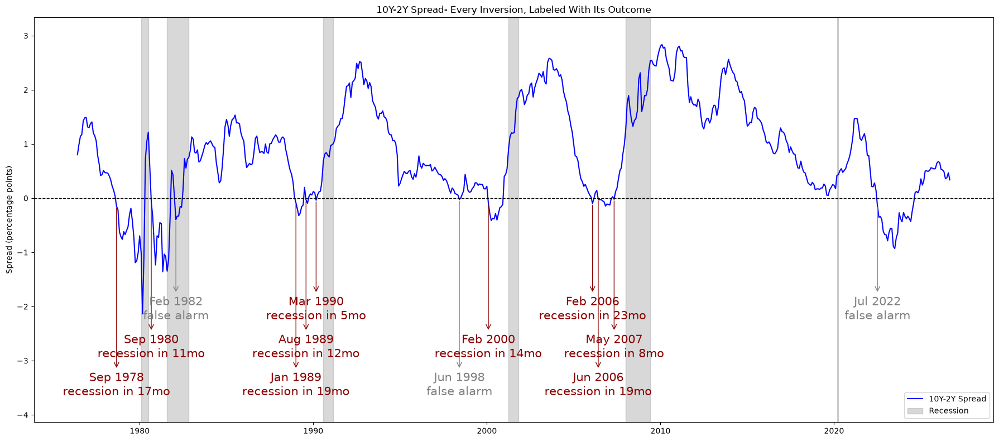
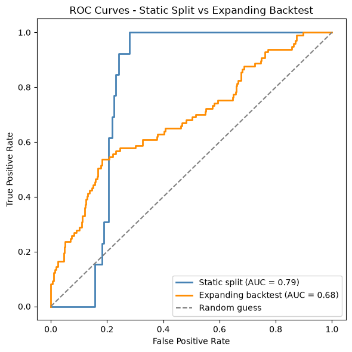

# Does an Inverted Yield Curve Predict US Recessions?

Every time the yield curve inverts, headlines declare a recession is coming. Markets move, analysts panic, and the "always-accurate indicator" gets wheeled out again. But how reliable is it, really? This notebook puts that claim to the test with actual data from FRED (Federal Reserve Bank of St. Louis) and finds the truth is far messier than the headlines suggest.

## What this notebook does

Using daily Treasury yield data and official NBER recession dates from FRED, this notebook:

- Calculates the 10Y-2Y yield spread (and the 10Y-3M spread, which the NY Fed's own model favours), and identifies every inversion since 1976

- Tests each inversion against actual recessions across a range of lag windows, measuring both hit rate and recall

- Attaches **bootstrap confidence** intervals and a permutation test to check whether the relationship is statistically significant, rather than down to chance

- Checks whether the **depth or duration** of an inversion affects how reliably it predicts a recession

- Builds a **logistic regression model** to estimate recession probability from the spread, evaluated both on a single train/test split and with an **expanding window backtest** that retrains over time

- Plots **ROC curves** to compare how well each approach separates recessions from non-recessions.

The analysis centres on the 10Y-2Y spread, the version most commonly cited in financial media, but also tests it against the 10Y-3M spread (the measure the NY Fed's own model prefers) to check whether the popular choice is actually the most reliable one. 

## Key findings

So, does an inverted yield curve predict US recessions? Based on this analysis **it does**, but far less reliably than the news headlines suggest.

- **The signal is real, but very slow.** An inversion tells you little over the next 6 months (8% hit rate, no better than random, p = 0.52). Stretch the window to 24 months and the hit rate climbs to 75%, with a permutation p-value of 0.0000. There's almost no random placement of dates could match that. It's a slow signal that needs 12-18+ months to play out.

- **But the sample is tiny, so confidence is low.** There have only been 12 inversions since 1976. That 75% hit rate carries a 95% confidence interval of 50-100%, which is wide enough that "75%" shouldn't be taken at face value. This small-sample uncertainty is the single biggest limitation of the project, and no statistical technique can fix simply not having more history.

- **10Y-3M beat 10Y-2Y.** The spread most cited in the media (10Y-2Y) was consistently outperformed by the one the NY Fed actually uses (10Y-3M) at every lag window.

- **Severity doesn't help.** Deeper or longer inversions were no more reliable than shallow, brief ones. In fact, false alarms were slightly deeper on average. The longest and deepest inversion in the dataset (2022) was a false alarm.

- **The model tells the same story.** A logistic regression on the spread reached a reasonable AUC (0.79 on a single split, 0.68 in a realistic expanding-window backtest), so it ranks risky periods above safe ones, but it rarely crossed a 50% probability, making it better at ranking risk than at binary yes/no calls.

**The verdict:** the inverted yield curve is a real recession signal, over a long enough horizon it beats chance clearly. But it's a very blunt, and slow instrument rather than the "always-accurate" indicator of the headlines, and treating a single inversion as a guaranteed recession countdown isn't supported by the data.

